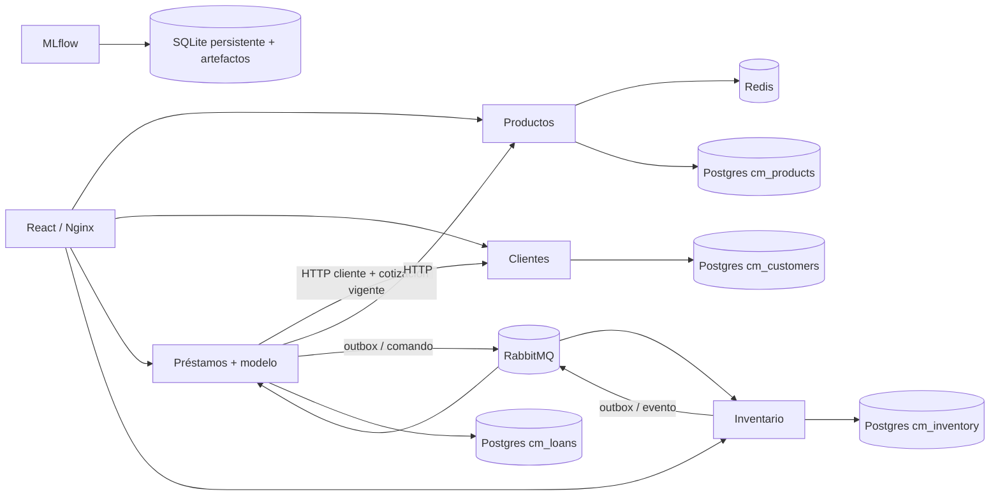
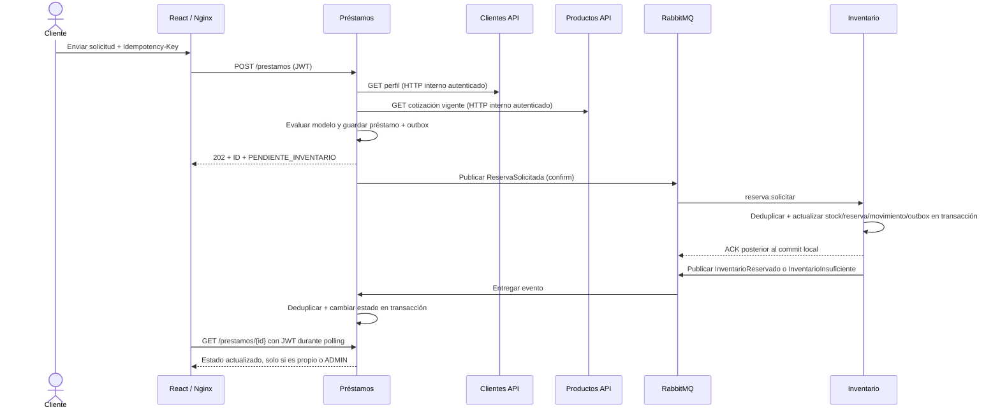
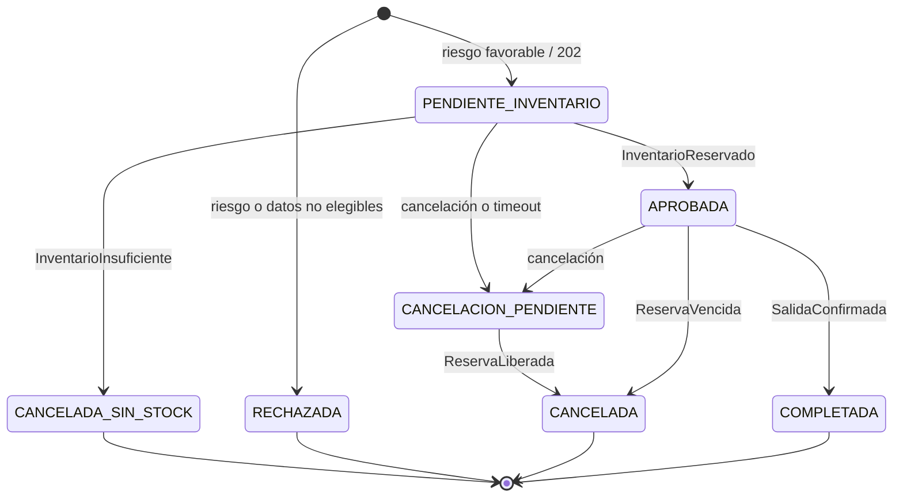

# Arquitectura actual

## Servicios

`domain_service/app.py` se despliega como cuatro procesos/contenedores independientes con `SERVICE=products|customers|loans|inventory`. Cada despliegue usa su propia base de datos PostgreSQL y rol restringido. El manifiesto de propiedad método/path genera un OpenAPI distinto para cada instancia; `/health` y `/ready` son las únicas operaciones compartidas. Los aliases históricos de Préstamos se mantienen marcados como obsoletos. Los handlers de otros dominios responden 404 por la guarda `require(SERVICE)`. Los servicios se comunican por HTTP interno autenticado o RabbitMQ; no consultan bases de datos ajenas.

## Flujo y estados

1. Préstamos obtiene cliente y cotización directamente de sus APIs. Calcula cuota francesa con 1,8 % mensual, construye las mismas features del entrenamiento y ejecuta el pipeline cargado al iniciar.
2. Una evaluación desfavorable se persiste en `RECHAZADA`; una favorable se persiste en `PENDIENTE_INVENTARIO` junto a `ReservaSolicitada` en outbox, antes de contestar 202.
3. El consumidor de Inventario reserva mediante un `UPDATE ... WHERE available >= quantity` dentro de una transacción. Reserva por `loan_id` único evita el doble efecto.
4. Inventario deja `InventarioReservado`/`InventarioInsuficiente` en su outbox. Préstamos deduplica por `event_id` y actualiza el estado en la misma transacción local.
5. Préstamos vence pendientes a los 2 minutos, el inventario vence reservas a los 30 minutos. Cancelar genera un comando de liberación; la confirmación tardía no modifica estados terminales.

Estados principales: `RECHAZADA`, `PENDIENTE_INVENTARIO`, `APROBADA`, `CANCELADA_SIN_STOCK`, `CANCELACION_PENDIENTE`, `CANCELADA`, `COMPLETADA`. La reserva es la fuente de verdad para aprobar y entregar.

### Secuencia de solicitud y actualización asíncrona

### Diagrama de estados

Un evento tardío se registra por `event_id`, pero solo avanza una transición permitida para el estado actual. Si se cancela mientras la reserva aún no llega, la liberación se conserva en outbox y compensa una reserva que se procese después; el caso de evento tardío y expiración se ejecuta en `scripts/acceptance_cancel_late.py`.

## Redis

Productos usa `productos:v1:{id}`, TTL de 300 segundos. Un hit se responde desde Redis; miss consulta PostgreSQL y llena el caché. Actualizar/desactivar confirma primero PostgreSQL y luego invalida. Fallo de Redis cae a la BD con timeout de socket de 200 ms. `/cache/metrics` publica hits, misses, fallback, tasa de aciertos, p50 y p95 del proceso actual. `/products/{id}/quotation` lee siempre la BD.

## Límites de arquitectura

- Los cuatro contenedores comparten el módulo de implementación `domain_service/app.py`; la separación se aplica por configuración `SERVICE`, propietario explícito de ruta, guardas de ejecución, roles y bases de datos. `loan_service/app.py` es código legado no utilizado por el entrypoint de Compose.
- Las tablas se crean al iniciar; no hay migraciones versionadas.
- Los demás requisitos aún no verificados están enumerados con su evidencia faltante en `MATRIZ_CUMPLIMIENTO.md` y `estado.md`.
